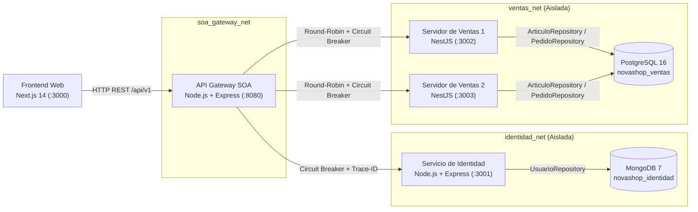

# Manual Técnico — NOVA Shop (UCH-FyD)

**Universidad Champagnat — Facultad de Informática y Diseño**  
**Licenciatura en Sistemas de Información — Cátedra: Arquitectura de Sistemas**  
**Grupo N.° 10:** Lucrecia Concatti, Camila Olivera, Rocío Santilli, Juan Narvaez.

---

## 1. Visión Arquitectónica General

**NOVA Shop** implementa una **Arquitectura Orientada a Servicios (SOA)** diseñada en tres iteraciones académicas (**TP1, TP2 y TP3-1**). La solución desacopla el dominio de **Identidad** del dominio transaccional de **Ventas (Catálogo y Pedidos)**, exponiendo todos los contratos bajo un único punto de entrada (**API Gateway** en `/api/v1`).



---

## 2. Decisiones Arquitectónicas (ADRs) y Patrones Implementados

| ADR / Driver | Patrón / Decisión | Implementación Técnica en el Código |
| :--- | :--- | :--- |
| **ADR-01 / DRV-02** | **Escalamiento Horizontal sin Estado** en el Servidor de Ventas | Se despliegan 2 réplicas stateless (`ventas-service-1` en `:3002` y `ventas-service-2` en `:3003`). El API Gateway distribuye las solicitudes mediante **Round-Robin** y expone la cabecera `X-Ventas-Instance`. |
| **ADR-02 / DRV-01** | **Control Transaccional Atómico de Stock** en PostgreSQL | En `ventas-service/src/pedidos/pedidos.service.ts` y `articulo.repository.ts`, cada confirmación de pedido abre una transacción SQL (`BEGIN`), ejecuta `UPDATE articulos SET stock = stock - $1 WHERE codigo = $2 AND stock >= $1 RETURNING *` y si alguna línea no tiene stock suficiente ejecuta `ROLLBACK` y devuelve `409 Conflict` sin pedidos parciales. |
| **ADR-03 / ADR-07** | ** Separación de Dominios y Capas Internas** (`Controller -> Service -> Repository`) | `identity-service` y `ventas-service` separan estrictamente controladores HTTP, lógica de negocio y acceso a datos. |
| **ADR-04 / DRV-08** | **API Gateway como Punto Único de Entrada** | `api-gateway/src/index.js` centraliza el prefijo `/api/v1`, valida firmas JWT localmente, aplica **Rate Limiting** en `/auth/login`, propaga `X-Trace-ID` y publica OpenAPI 3 en `/api/v1/docs`. |
| **ADR-05 / DRV-03** | **Patrón Circuit Breaker** (Timeout `3s`, Recuperación `30s`) | Implementado en `api-gateway/src/circuit-breaker.js` y en `ventas-service/src/auth/jwks.service.ts`. Evita fallas en cascada y responde `503 Service Unavailable` cuando un servicio aguas abajo supera el umbral de fallos. |
| **ADR-06 / DRV-04** | **Patrón Repository y Aislamiento de Bases de Datos** | `UsuarioRepository` encapsula Mongoose/MongoDB (`identidad_net`) y `ArticuloRepository` / `PedidoRepository` encapsulan SQL/PostgreSQL (`ventas_net`). Ningún servicio accede a la base de datos de otro dominio. |
| **ADR-08 / DRV-07** | **Autenticación JWT Asimétrica (`RS256`, 15 min) + JWKS** | `identity-service/src/keys.js` genera un par de claves RSA 2048-bit, firma los JWT con la clave privada (`RS256`, `expiresIn: '15m'`) y publica la clave pública en `GET /api/v1/auth/jwks`. Tanto el API Gateway como las instancias de Ventas validan el JWT localmente usando la clave pública cacheada, sin consultar a Identidad en cada compra. |
| **ADR-09 / DRV-06** | **Idempotencia en Confirmación de Pedidos (`Idempotency-Key`)** | `POST /api/v1/pedidos` exige la cabecera `Idempotency-Key`. La tabla `pedidos` almacena `idempotency_key UNIQUE` junto con `response_snapshot`. Si un cliente reintenta la misma compra, se devuelve el pedido ya registrado (`HTTP 200`) sin volver a descontar stock. |

---

## 3. Modelo de Datos y Persistencia Políglota

### 3.1. Servicio de Identidad — MongoDB (`novashop_identidad`)
Archivo: [`identity-service/src/models/usuario.model.js`](./identity-service/src/models/usuario.model.js)

Colección `usuarios`:
- `username` (`String`, único, indexado, `SUP-06`)
- `email` (`String`)
- `nombreCliente` (`String`)
- `passwordHash` (`String`, hash `bcrypt` con factor de costo 10 — nunca expuesto en respuestas HTTP)
- `rol` (`String`, enum: `['cliente', 'administrador']`, por defecto `'cliente'`)
- `estado` (`String`, enum: `['inactivo', 'activo']`, por defecto `'inactivo'` según `RF-02`)
- `createdAt` / `updatedAt` (`Date`)

### 3.2. Servidor de Ventas — PostgreSQL 16 (`novashop_ventas`)
Archivo: [`ventas-service/src/database/database.service.ts`](./ventas-service/src/database/database.service.ts)

- **Tabla `articulos`**:
  - `codigo VARCHAR(32) PRIMARY KEY`
  - `nombre VARCHAR(160) NOT NULL`
  - `descripcion TEXT`
  - `precio_unitario NUMERIC(12, 2) NOT NULL CHECK (precio_unitario >= 0)`
  - `stock INTEGER NOT NULL CHECK (stock >= 0)` *(Garantiza a nivel motor que jamás exista stock negativo)*
- **Tabla `pedidos`**:
  - `numero SERIAL PRIMARY KEY`
  - `fecha TIMESTAMPTZ NOT NULL DEFAULT NOW()`
  - `usuario VARCHAR(80) NOT NULL`
  - `nombre_cliente VARCHAR(160) NOT NULL`
  - `importe_total NUMERIC(12, 2) NOT NULL CHECK (importe_total >= 0)`
  - `idempotency_key VARCHAR(120) UNIQUE`
  - `response_snapshot JSONB`
- **Tabla `pedido_lineas`**:
  - `id SERIAL PRIMARY KEY`
  - `pedido_numero INTEGER NOT NULL REFERENCES pedidos(numero) ON DELETE CASCADE`
  - `codigo_articulo VARCHAR(32) NOT NULL REFERENCES articulos(codigo)`
  - `nombre_articulo VARCHAR(160) NOT NULL`
  - `cantidad INTEGER NOT NULL CHECK (cantidad > 0)`
  - `precio_unitario NUMERIC(12, 2) NOT NULL`
  - `subtotal NUMERIC(12, 2) NOT NULL`

---

## 4. Contratos de Servicios REST (`/api/v1`)

La especificación completa OpenAPI 3.0.3 se encuentra en [`api-gateway/src/openapi.js`](./api-gateway/src/openapi.js) y puede consultarse interactivamente en `http://localhost:8080/api/v1/docs`.

| Método y Ruta | Servicio Destino | Autenticación / Rol | Descripción y Códigos de Respuesta |
| :--- | :--- | :--- | :--- |
| `POST /api/v1/auth/registro` | Identidad (`:3001`) | Público | Registra un usuario con rol `cliente` y estado `inactivo` (`201`, `400`, `409`). |
| `POST /api/v1/auth/login` | Identidad (`:3001`) | Público (con Rate Limit) | Autentica usuarios activos y emite JWT `RS256` por 15 min (`200`, `401`, `403` si inactivo, `429`). |
| `GET /api/v1/auth/jwks` | Identidad (`:3001`) | Público | Publica la clave pública RSA en formato JWK (`200`). |
| `GET /api/v1/usuarios?estado=inactivo` | Identidad (`:3001`) | JWT (`administrador`) | Lista usuarios filtrados por estado sin campos sensibles (`200`, `401`, `403`). |
| `PATCH /api/v1/usuarios/:id/activacion` | Identidad (`:3001`) | JWT (`administrador`) | Activa o desactiva una cuenta en MongoDB (`200`, `400`, `401`, `403`, `404`). |
| `GET /api/v1/articulos` | Ventas (`:3002/:3003`) | Público | Lista el catálogo completo con precios y stock disponible (`200`). |
| `GET /api/v1/articulos/:codigo` | Ventas (`:3002/:3003`) | Público | Devuelve el detalle de un artículo por su código (`200`, `404`). |
| `PUT /api/v1/articulos/:codigo` | Ventas (`:3002/:3003`) | JWT (`administrador`) | Crea o actualiza un artículo del catálogo (`200`, `401`, `403`). |
| `PATCH /api/v1/articulos/:codigo/stock` | Ventas (`:3002/:3003`) | JWT (`administrador`) | Ajusta el stock entero no negativo de un artículo (`200`, `400`, `403`, `404`). |
| `POST /api/v1/pedidos` | Ventas (`:3002/:3003`) | JWT (`cliente`/`admin`) + `Idempotency-Key` | Confirma un pedido en transacción SQL y descuenta stock (`201`, `200` replay, `400`, `401`, `404`, `409`). |
| `GET /api/v1/pedidos` | Ventas (`:3002/:3003`) | JWT (`cliente`/`admin`) | Lista los pedidos propios del cliente o todos si es administrador (`200`, `401`). |
| `GET /api/v1/pedidos/:numero` | Ventas (`:3002/:3003`) | JWT (`cliente`/`admin`) | Consulta un pedido específico verificando propiedad (`200`, `403`, `404`). |

---

## 5. Despliegue, Inicialización y Pruebas de Verificación

### 5.1. Levantar la Infraestructura Completa
```powershell
docker compose up --build -d
```

### 5.2. Inicialización Segura del Administrador (`RF-04`)
El proyecto incluye el script [`identity-service/src/scripts/init-admin.js`](./identity-service/src/scripts/init-admin.js), que lee las credenciales desde variables de entorno sin dejarlas fijas en el código fuente:

```powershell
docker exec -e ADMIN_USERNAME=admin -e ADMIN_EMAIL=admin@uch.edu.ar -e ADMIN_PASSWORD=TuClaveAdminSegura novashop-identity-service npm run init-admin
```

### 5.3. Scripts de Verificación Automatizada
- **`node scripts/test-rf04.js`**: Ejecuta los 8 casos de prueba de `RF-04` (bloqueo 401 sin token, registro inactivo ignorando inyección de rol admin, rechazo 403 en login inactivo, login admin, consulta de pendientes sin hashes, activación `PATCH`, login de usuario activado y rechazo 403 de usuario normal en rutas admin).
- **`node scripts/verificar-arquitectura.js`**: Verifica trazabilidad `X-Trace-ID`, balanceo de carga Round-Robin entre `ventas-instance-1` y `ventas-instance-2`, compra concurrente (`2×4` unidades sobre `A-1001` con stock `5` → un `201 Created`, un `409 Conflict` y stock final `1`), y reintento con `Idempotency-Key`.
- **`node scripts/test-carga-rnf02.js`**: Ejecuta ráfagas concurrentes sobre el API Gateway para validar el atributo de calidad `RNF-02` (tiempo de respuesta menor a 2 segundos y tasa de éxito superior al 99%).
